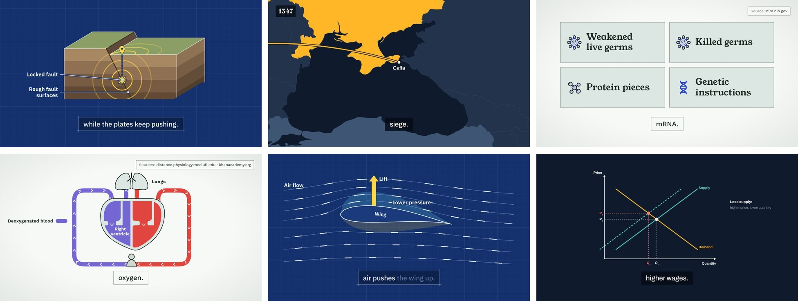
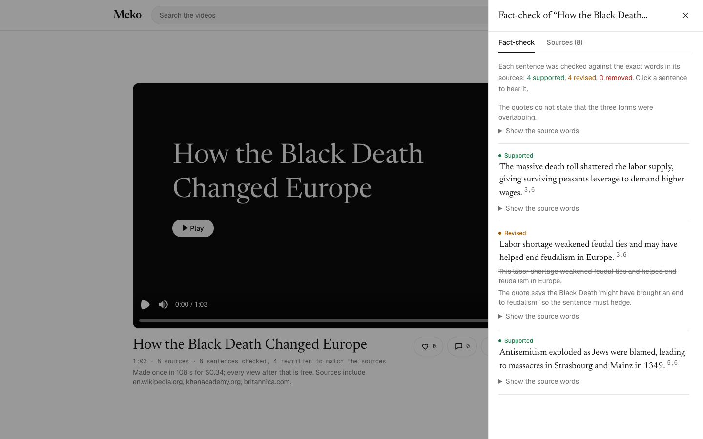
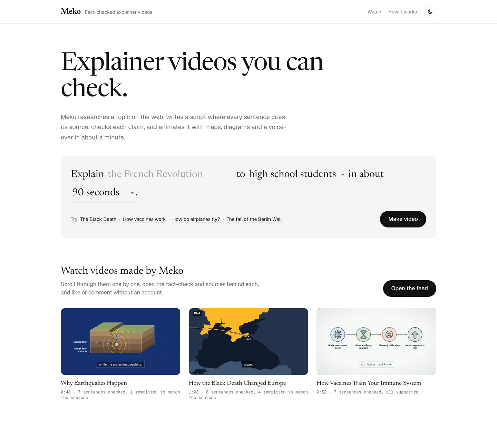

# Meko

Meko turns a topic into a short, fact-checked, animated explainer video in under a minute.

**Live demo: [meko-kappa.vercel.app](https://meko-kappa.vercel.app)**

You type a topic, an audience and a length, for example "The French Revolution, high school, 90 seconds". An agent researches the topic on the web, writes a narration where every sentence cites its sources, fact-checks that narration against the exact words of those sources, and directs each scene as an animated map, timeline, chart, quote, list or chain of causes. The video plays right away in the browser, with a voice-over, the sources and a sentence-by-sentence fact-check report next to it.

The point: explainer videos people can trust, made in under a minute.



Meko is built for the Nebius x NVIDIA Global AI Hackathon (track: Best Apps and Agents). Every video is made by NVIDIA Nemotron, served by Nebius Token Factory.

## Try it

Open the live demo at [meko-kappa.vercel.app](https://meko-kappa.vercel.app).

- **Watch** shows videos Meko made, one per screen, to scroll through. Open **Fact-check** on any of them to see every sentence next to the source words behind it; in the Black Death video, four sentences were rewritten because the sources only say the plague "might have" ended feudalism. You can like and comment without an account.

  

- **Make a video**: type a topic, pick an audience and a length, and choose **Make video**. Each step shows its progress, and the video plays when it is done, in about a minute. The hosted demo asks for a demo code, so strangers cannot spend the API credits; judges find it in the submission's testing instructions. A topic someone already made, with the same audience and length, plays at once from the library.

  

## Why you can trust a Meko video

The language model writes and checks everything, but plain code checks the model at every step:

- **Every fact has a quote.** When Meko reads a source, the model must copy the exact words that state each fact. The server looks for that quote in the source text and throws the fact away if it is not there, so the model cannot invent facts.
- **Every sentence cites facts.** The script must name the facts behind each sentence. Unknown fact IDs send the script back for another try.
- **Every claim is checked.** The fact-check splits each sentence into its separate claims (people, numbers, dates, places, causes) and judges each one only against the quotes of the cited facts. Links count as claims too: two true facts joined by a false "after" or "because" make a false sentence, so the code spells out each link for the model to judge. So do the order of steps ("first", "then") and certainty: when a source says the plague "might have" ended feudalism, the narration may not say it did. Two checks run side by side and the stricter verdict counts. A sentence with an unsupported claim is rewritten or removed, and the code makes sure it can never be marked as supported.
- **The narration is not touched again.** The director only chooses what is shown on screen. The voice reads the fact-checked text word for word.
- **What is on screen is checked too.** Numbers on screen must appear in the narration or the cited facts, and labels must use their words; a one-word answer like "Yes" or "No" on a scoreboard must be one of them too. A number the sources give as a range ("25 to 50 million") is shown as the whole range, with the uncertain part drawn as an outline. Each bar on a chart needs a sentence in the scene that gives that number for that thing. Each event on a timeline names the fact that states its year (and its date, for events in the same year), and the code checks that they are in it; a period drawn under the events must be one a fact states, like "ruled from 1451 to 1481". A quote must be a whole sentence copied word for word from a source, never a shortened one. Each city on a map comes with its coordinates and the country it lies in, and the code checks that the point is inside that country's borders and asks the model a second time, in a separate call, where the city is. The same second opinion checks the labels on countries: a label that names a city, or a place in another country (the model once labeled Georgia "Caffa", a port in Crimea), is taken off, and a map must show a place its own scene names. Words on screen keep the narration's hedges, so "may have helped end feudalism" never becomes a card that says "End of feudalism", and "up to half" never becomes "half". A country cannot carry the name of a region it is not in, and an arrow labeled "eastward" must point east, which it may only say when the narration does. A video that is not about places, and a scene about space, gets no map. Figures stand only for people the narration names, drawn by the role they play, never by gender or looks. Route stops and places on the Moon come from tables in the code (cities from Natural Earth, Moon seas and landing sites from the USGS and NASA), never from the model's memory, and icons come from a fixed set drawn in code. Dots that show a number as part of a whole need the narration to say exactly that, a chart cannot compare dates or one amount in two units, and a number in a name (Apollo 11) is never shown as an amount.
- **You can see all of it.** Every scene names the sites its facts come from in a corner of the video, and the video ends with credits that list every source and the result of the fact-check. When a scene quotes a source, a marker sweeps over the source's words while the claim is spoken. Next to the video, the fact-check report lists every sentence as supported, revised or removed, with the reason, the quotes and links to the sources. The sentence being spoken is marked as the video plays, and clicking a sentence plays the video from there.

## How it works

The browser calls five API routes in order and shows live progress for each:

1. **Research** (`/api/research`). First, next to the search plan so it adds no time, Nemotron checks that the topic fits an educational explainer. Hard subjects like war, disease or extremism told as history or science are fine; requests for instructions to hurt someone or oneself, for weapons, drugs or breaking into accounts, sexual content, attacks on people, a private person, or text that is not a topic at all are turned down with a plain message before any search. Nemotron plans 3 to 6 web searches. [Tavily](https://tavily.com) runs them in parallel, preferring encyclopedias, museums and public bodies and leaving out homework-help, essay and Q&A sites. Meko picks the best new page for each search, and Nemotron extracts up to 6 facts from each page, with quotes, all at once. If the model finds an important gap, there is one more round of searches.
2. **Script** (`/api/script`). Nemotron writes the narration, split into short scenes, with the fact IDs behind every sentence, and the question the video answers, which opens the video on the title card. The length follows the voice's measured pace of about 15 characters per second, counting numbers as the words the voice says ("1347" is "thirteen forty-seven") and leaving time for the credits; a script that is still too long loses sentences from its middle scenes.
3. **Fact-check** (`/api/factcheck`). Nemotron checks every claim in every sentence against the quotes, twice at the same time, and the stricter verdict counts. Sentences are kept, revised or removed.
4. **Direct** (`/api/direct`). One Nemotron call picks the look of the video from its topic (Night atlas for history and politics, Blueprint for science and technology, Field guide for nature and the body), describes in one sentence what the viewer should see in each scene, and ranks the kinds of picture that show it. The code picks a varied order from them, using only kinds the facts have data for: no timeline without years, no chart without numbers, no maps in a video that names no countries or regions, and no two scenes in a row that look alike. A second call, as a demanding editor, challenges the plan and may swap up to three scenes for a picture that shows the narration better. Then every scene is directed in its own small call, all in parallel. Besides maps, timelines, big numbers, charts, quotes, chains of causes, cards, scoreboards and figures, a scene can use one of more than 40 animated templates from Meko's own template library (`remotion/filmmotor`), like a cycle, a pyramid, a Venn diagram, pros and cons, a myth and the fact that busts it, a definition card, a year that rolls, a calendar page, a donut chart, a line chart, a document, a letter in its writer's own words, a formula or a funnel, each with its own checks against the sources. A video about how something works gets a scene drawn for it. More than 30 ready-made, animated drawings cover common topics: a volcano erupting, plate boundaries, earthquakes, the heart, the lungs, digestion, the eye, viruses, natural selection, food chains, photosynthesis, the water and carbon cycles, hurricanes, eclipses, black holes, how a wing lifts, solar panels, batteries, nuclear fission, how a fridge works, rockets, engines, and how neural networks, language models, GPUs and the internet work. Each is offered only when the narration explains that process, and what it shows (an eruption, a cell bursting open, an image landing upside down) follows what the narration says. For every other topic there is a kit of four pictures that adapt to any content: a cutaway (what is inside or under something), a journey (one thing travelling through stages), input and output (what a process takes in and gives out) and forces (the arrows on one thing). The model only says what is in them, by name, icon and place in words, and the code lays them out, places the labels and times each part to the voice, since language models are good at words and bad at geometry. Every word on them is checked like the rest: a flow between two things, a link in a food chain or a station on a journey must be stated by the narration, in its order. The opening varies too: a globe for a video about places, a big icon for its topic, the question it answers, or the years it spans rolling by. Some scenes are then drawn with another template for the same content, like a cause chain or a page of the source with the quote marked, so two videos rarely look alike.
5. **Voice** (`/api/voice`). [ElevenLabs](https://elevenlabs.io) reads each scene, with the text before and after for a natural flow. Its word timings set the length of each scene, drive captions that light up word by word, and time the pictures: a country lights up, a city appears or an arrow draws as the voice names it. A scene that names a year shows it in the corner. When two maps follow each other, the camera flies from one to the next; a map about a city first shows its country, then zooms in; and a video with maps that would end on plain text ends on a map of every place it showed instead. Every scene moves slowly, so no picture stands still, and soft sound effects made in code (a thud when a number lands, a rush of air when a map zooms in, a bell at the start and the end) sit under the voice.

The result is a storyboard (plain JSON, see `lib/storyboard.ts`) that [Remotion](https://www.remotion.dev) plays in the browser. All visuals and sounds are made in code: no stock footage, images, music or recorded sounds.

**The feed.** `/watch` shows videos made by Meko, one per screen, to scroll through like a short-video app, with search over titles, narration and sources. Under each video it says how long the video took to make and what it cost, and that watching it again costs nothing, since it plays from saved files. The feed's videos were made with `npm run make-example`; for some, the director ran a second time on the same narration and we kept the better picture for each scene, and the cost and time shown include both runs. Viewers can like and comment without an account: each browser gets a made-up name like "Curious Heron 17", comments are limited in length and in how often one can post, and comments with links, swear words or slurs are turned down.

**The library.** Every finished video is saved in [Vercel Blob](https://vercel.com/docs/vercel-blob): the storyboard, the voice, the facts, the sources and the fact-check report. When someone asks for the same topic, audience and length again, the saved video plays at once and costs nothing, with a note saying when it was made and a button to make a new one. The diagrams the model draws are saved too, and a later scene about something similar gets the closest ones as examples, so the drawings improve as the library grows.

On 10 test topics across history, science, nature, the body and technology (none of them in the feed), every video finished, and 97% of the sentences were supported as written; the fact-check rewrote the rest. Asked for 90 seconds, Meko made videos of 66 to 81 seconds in about 42 seconds each, for about $0.15 in Token Factory calls, plus 3 to 12 Tavily searches and the voice. Since Nemotron 3 Super directs the scenes, the same videos come to about $0.065 each. See `docs/eval.md`.

We also tested the fact-check against answers known in advance. It caught all 44 sentences with a planted error (wrong numbers, dates, order, causes, hedges, people and places) and left all 14 correct ones alone. Reading 30 feed claims against the source pages themselves, 25 were supported, 5 went a step beyond their source (two of them since fixed), and none was false; 74 of the 82 quotes behind them were found word for word on the pages, and the other 8 could not be checked. See the trust test in `docs/eval.md`.

## How Meko uses Nemotron and Token Factory

- **Models.** Three Nemotron models on Nebius Token Factory, each where it does best, called with the `openai` SDK through Token Factory's OpenAI-compatible API (`https://api.tokenfactory.nebius.com/v1/`). `nvidia/Nemotron-3-Ultra-550b-a55b` does everything that needs careful reasoning: the topic check, planning the searches, writing the script, the fact-check, planning the video and checking every place on a map. `nvidia/nemotron-3-super-120b-a12b`, at about a third of Ultra's price, directs each scene: re-directing the ten eval videos with it cost $0.037 a video for that step instead of $0.120 with Ultra, about as fast, with the same share of plain-text scenes (11 %) and the same checks passed. `nvidia/Nemotron-3_5-Lightning`, at about 6 % of Ultra's price, does the fast everyday calls: pulling facts with their quotes out of each source page (many small calls at once) and naming the opening card. If Lightning does not answer within 20 seconds, Super takes the call, and Lightning's calls for the next 5 minutes. On the same topics, extraction with Lightning kept about 90 % as many facts at a sixth of the cost (Ultra still plans the searches; when Lightning planned them too, it read fewer sources), and the share of supported sentences held. We picked the models with `scripts/check-models.ts`, which tested the four Nemotron models on Token Factory for strict JSON, tool calling, speed and price; Ultra was the only one that got every storyboard right. See `docs/model-check.md`.
- **Thinking off.** Every call sends `chat_template_kwargs: { enable_thinking: false }`. In our tests, thinking made calls 2 to 10 times slower and never gave better results for these tasks, not even for the fact-check (see `FEEDBACK.md`).
- **Strict structured output.** Every call uses `response_format: { type: "json_schema", strict: true }` with a schema built from zod. Token Factory enforces list limits like `maxItems` from the schema (we tested it), which Meko uses to stop runaway lists. The reply is validated again with zod.
- **Checks and retries.** If a reply breaks a rule that a schema cannot express (an unknown fact ID, a number that is not in the sources, a city in the wrong country), the problems go back to the model, at most twice. If a scene's direction still breaks a rule after that, its broken parts are dropped instead of failing the whole video. If any other step fails, the app explains why and can try again from that step.
- **Speed.** Fact extraction and scene direction run as many small calls in parallel. Every call has a timeout and a token cap, and every step stops retrying in time to stay within its route's time limit.
- **Cost tracking.** Every call logs tokens, latency and cost, and the app shows the cost of each video.

What was confusing, slow or broken along the way is written down in `FEEDBACK.md`.

## How Meko uses Tavily

[Tavily](https://tavily.com) is where every fact in a Meko video comes from, and its passages are what the fact-check holds the narration to.

- **Planned, parallel searches.** Nemotron plans 3 to 6 searches for the topic, audience and length, and Meko runs them on Tavily at the same time. One failed search does not stop the others.
- **Advanced depth with passages.** Each search uses `search_depth: "advanced"` with `chunks_per_source: 3`, so Tavily returns the three passages of each page that best match the query, instead of a short snippet. Those passages are the text the facts are drawn from.
- **Trusted sources first.** `include_domains` with `include_domains_mode: "prefer"` steers Tavily toward 30 encyclopedias, museums, public bodies and science organizations without shutting out other good pages, and `exclude_domains` leaves out 40 homework, essay, Q&A, social and video sites. Meko then ranks each search's results by trust (preferred sites, `.gov`, `.edu` and museums, then other organizations) and Tavily's score, and takes the best new page from each search in turn, so every part of the plan gets a source and no page is read twice.
- **Tavily's text is the ground truth.** For each page, Nemotron 3.5 Lightning pulls out up to 6 facts, each with the exact words that state it. The server looks for those words in the passages Tavily returned and throws away any fact whose quote is not there. The fact-check later judges every sentence against these quotes, the report shows them next to each sentence, and a quote scene marks them on a page of the source.
- **A second round for gaps.** When Nemotron finds something important missing, it writes up to 3 more searches and Tavily runs them, at most once and only while there is time.
- **Cost.** A video makes 3 to 12 advanced searches (2 credits each). Without a key, Meko uses Tavily's keyless mode for development.

## Setup

You need Node.js 22.18 or newer and npm.

1. Install the dependencies:

   ```bash
   npm install
   ```

2. Copy `.env.example` to `.env.local` and fill in the values. `.env.local` is gitignored, so your keys stay on your machine.

   | Name | What it is |
   | --- | --- |
   | `NEBIUS_API_KEY` | API key for Nebius Token Factory |
   | `NEBIUS_MODEL` | Optional: the model for the reasoning steps. Leave it empty to use `nvidia/Nemotron-3-Ultra-550b-a55b` |
   | `TAVILY_API_KEY` | API key for Tavily web search. Without it, Meko uses Tavily's free keyless mode, which has a low hourly limit and is only meant for development |
   | `ELEVENLABS_API_KEY` | API key for ElevenLabs text-to-speech. Without it, videos play silently with captions |
   | `ELEVENLABS_VOICE_ID` | The ElevenLabs voice. Meko uses the default voice George, `JBFqnCBsd6RMkjVDRZzb` |
   | `DEMO_CODE` | Needed on Vercel: making a video asks for this code, so strangers cannot spend your API credits. Without it, the deployed app makes no new videos. Use a long random code. Leave it empty locally |
   | `BLOB_READ_WRITE_TOKEN` | Optional, for running the library on your own machine: the read-write token of a public Vercel Blob store. On Vercel, connecting the store is enough. Without either, every video is made fresh and nothing is saved |

3. Start the dev server and open http://localhost:3000:

   ```bash
   npm run dev
   ```

   To see finished videos without any API keys, open the feed at http://localhost:3000/watch.

## Commands

| Command | What it does |
| --- | --- |
| `npm run dev` | Starts the dev server on http://localhost:3000 |
| `npm run build` | Builds the app for production |
| `npm run start` | Serves the production build |
| `npm run lint` | Runs ESLint |
| `npm run typecheck` | Generates route types and runs the TypeScript compiler |
| `npm run eval -- 2` | Makes videos for the first 2 of 10 test topics and writes the table at the top of `docs/eval.md`. Leave out the number to run all 10. Needs the app running and makes paid API calls |
| `npm run make-example -- black-death` | Remakes one video of the feed in `public/examples`, with its voice (the slugs are in `lib/example.ts`). Needs the app running and makes paid API calls |
| `npm run check-models` | Tests the NVIDIA models on Token Factory and writes `docs/model-check.md`. Makes paid API calls, capped at 1 USD |

## Deploy

Meko runs on [Vercel](https://vercel.com) with no extra configuration:

1. In Vercel, choose Add New, then Project, and import the GitHub repository.
2. Add the environment variables from the table above, including `DEMO_CODE`. The feed plays for everyone; making a new video asks for the code. A long random code is what stops people from guessing it. The app also limits new videos to 150 a day in all and 30 from one address in ten minutes (`lib/video-limits.ts`; videos already made play without limit), and a rate-limit rule on `/api/*` in the Vercel Firewall adds more protection. If you add or change a variable later, deploy again, since Vercel only applies it to new deployments.
3. For the library, open the project's Storage tab, create a Blob store with public access and connect it to the project. Vercel then sets `BLOB_STORE_ID`, and the app signs in to the store with OIDC on its own.
4. Deploy. Every push to `main` deploys again.

Each API route sets its own `maxDuration`, at most 180 seconds, which is within Vercel's 300-second limit on every plan.

## Project structure

| Folder | What is in it |
| --- | --- |
| `app/` | The start page, the feed (`/watch`), the five API routes, and the routes for the library, likes and comments |
| `components/` | The topic form, the player, the fact-check report and the feed |
| `lib/` | One file per pipeline step, the Token Factory, Tavily and ElevenLabs clients, the storyboard contract and the theme |
| `lib/prompts/` | One file per prompt |
| `remotion/` | The video: its scenes, the captions and the template library with its drawings (`remotion/filmmotor`) |
| `scripts/` | The model check, the eval and the maker of the feed's videos |
| `docs/` | The model check and eval reports |

All colors, fonts, sizes and timings are in `lib/theme.ts`.

## Known limitations

- Maps use today's borders, from Natural Earth via world-atlas. Historical borders are out of scope, so a map about the Roman Empire shows modern countries. Crimea is drawn as part of Ukraine, following the borders the UN recognizes. Antarctica is left off the maps.
- Maps show countries and cities, not streets. A map zooms in to an area of about 550 km at most, since the coastlines are simplified, so a story that happens inside one city (like the fall of the Berlin Wall) gets simple maps.
- Topics without places, like how vaccines work, get no maps; they lean on diagrams from the template library instead.
- Meko trusts its sources. It checks that the narration matches what the sources say, not whether the sources are right. The source list is there so you can judge them.
- Norwegian output is not supported yet. The models we tested write weak Norwegian.
- Videos play in the browser. There is no MP4 export yet.

## Credits and license

Meko's own code is MIT licensed, see [LICENSE](LICENSE).

- [Remotion](https://www.remotion.dev) plays the videos. Remotion is not MIT licensed. It has its own license, which is free for individuals, non-profits and companies with up to 3 employees. Larger companies need a paid company license. See the [Remotion license](https://www.remotion.dev/docs/license).
- The animated templates in `remotion/filmmotor` come from a film engine made during the submission period, first for a history film in Norwegian, then extended and adapted for Meko. They are part of this repository under its MIT license.
- Country shapes come from [Natural Earth](https://www.naturalearthdata.com) (public domain) through [world-atlas](https://github.com/topojson/world-atlas) (ISC).
- Country codes come from the [DataHub country-codes dataset](https://github.com/datasets/country-codes) (Public Domain Dedication and License).
- Fonts: [Newsreader](https://fonts.google.com/specimen/Newsreader), [Geist](https://fonts.google.com/specimen/Geist), [Geist Mono](https://fonts.google.com/specimen/Geist+Mono), [Fraunces](https://fonts.google.com/specimen/Fraunces), [Archivo](https://fonts.google.com/specimen/Archivo), [Big Shoulders](https://fonts.google.com/specimen/Big+Shoulders), [IBM Plex Sans](https://fonts.google.com/specimen/IBM+Plex+Sans), [IBM Plex Mono](https://fonts.google.com/specimen/IBM+Plex+Mono), [Young Serif](https://fonts.google.com/specimen/Young+Serif) and [Work Sans](https://fonts.google.com/specimen/Work+Sans), all under the SIL Open Font License.
- Web search by [Tavily](https://tavily.com) and voice by [ElevenLabs](https://elevenlabs.io).
